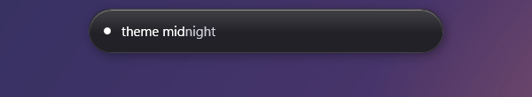
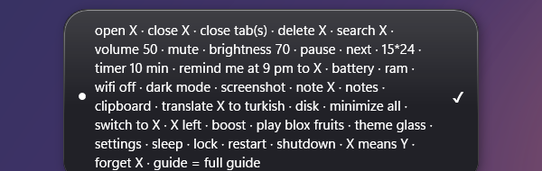

# PC Island

A floating command bar for Windows, shaped like the iPhone's Dynamic Island. Type what you want and it happens: open apps, close tabs, change the volume, set timers, translate, join a Discord voice channel, start a Roblox game. It understands English and Turkish, and can use a small AI that runs on your own PC.

<p align="center">
  <br>
  <br>
  <br>
  
</p>

<!-- Taking screenshots: turn on "Stream mode" in Settings first, otherwise the island hides from screenshots (that's how its blur works). -->

## What it does

| Area | Examples |
|---|---|
| Apps and windows | `open discord`, `discord'u aç`, `close chrome`, `switch to chrome`, `chrome left`, `minimize all` |
| Browser tabs | `close tab`, `close 3 tabs`, `close tabs on chrome` (keeps the browser open) |
| Files and web | `open downloads`, `delete old_video.mp4` (always asks first), `roblox.com`, `search how to fix wifi` |
| Music and sound | `pause`, `next`, `volume 40`, `sesi kıs`, `mute`; the pill shows the song that's playing |
| Screen and PC | `brightness 70`, `battery`, `ram`, `disk`, `wifi off`, `dark mode`, `screenshot`, `lock` |
| Time | `timer 10 min`, `remind me at 9 pm to study`, `20 dakika sonra yemek ye hatırlat` |
| Notes and more | `note buy milk`, `notes`, `clipboard`, `15*24`, `%18 of 250` |
| Translate | `translate water to turkish`, `water türkçesi`, `how do you say thank you in german` |
| Games | `play brookhaven`, `open am` (finds Roblox games by name, even short ones), `boost` |
| Discord | `join lounge vc in study group` |
| AI (optional) | `open the thing I play music with`, `what does gravity mean?` |

Type `guide` in the island for the full guide, with a search box and examples you can click to try.

## Features

- **Floating island:** opens with **Ctrl+Space** or when the mouse comes near; grows, morphs and shrinks back.
- **Six frosted glass themes:** Glass, Black, Midnight, Violet, Ember, Light.
- **Types ahead:** gray guesses while you type (Tab accepts), learns the words you use, remembers your history.
- **Live in the pill:** the song that's playing (hover for controls), timer countdown, battery alerts.
- **Safe by default:** deleting, closing apps and shutting down always ask first. Deleting is permanent, so it shows the file's size and location.
- **Game friendly:** hides during fullscreen games (Ctrl+Space still works), can put Roblox on high priority, closes background apps on `boost`.
- **Stream mode:** shows the island in screen shares (the blur is turned off while it's on).
- **Your own shortcuts:** name a list of commands (for example "gaming mode") and run them all at once.

## AI (optional, off by default)

PC Island can use a small AI model that runs **on your PC**: it's free, works offline, and nothing you type is sent anywhere. It only wakes up when the island doesn't understand you, and unloads right after, so games aren't slowed down.

Turn it on in **Settings → AI** and pick a model:

| Model | Download | Good for |
|---|---|---|
| Tiny (Qwen3 0.6B) | 0.6 GB | Older PCs and laptops without a graphics card |
| Fast (Qwen3 1.7B) | 1.0 GB | Most PCs |
| Smart (Qwen3 4B) | 2.3 GB | Best understanding, needs about 3 GB of graphics memory |

The picker marks the best one for your PC. Models are downloaded from Hugging Face and checked before use.

## Install

1. Download `PC Island.exe` from [Releases](../../releases).
2. Run it. Windows may show "Windows protected your PC" because the app isn't signed yet: click **More info → Run anyway**.
3. It starts with Windows by default (you can turn that off in Settings).

Requires Windows 10 or 11 (64-bit). Nothing else needs to be installed.

## Privacy

Everything runs on your PC. The app goes online only when you ask for something online: opening websites, Roblox game search, downloading an AI model, or Google Translate when AI is off. Settings, notes and history are stored in `%APPDATA%\PCIsland`; AI models in `%LOCALAPPDATA%\PCIsland\models`. Clipboard history is kept in memory only.

## Build from source

Needs the [.NET 10 SDK](https://dotnet.microsoft.com/download).

```powershell
cd PCIsland
dotnet build -c Release
# single-file exe:
dotnet publish -c Release -r win-x64 --self-contained true -p:PublishSingleFile=true -p:IncludeNativeLibrariesForSelfExtract=true -o ..\publish
```

Tests: `cd Tests; dotnet run -c Release`

## License

PC Island is free software under the **GNU General Public License v3.0**. See [LICENSE](LICENSE). Parts made by others are listed in [THIRD_PARTY_NOTICES.md](THIRD_PARTY_NOTICES.md).
